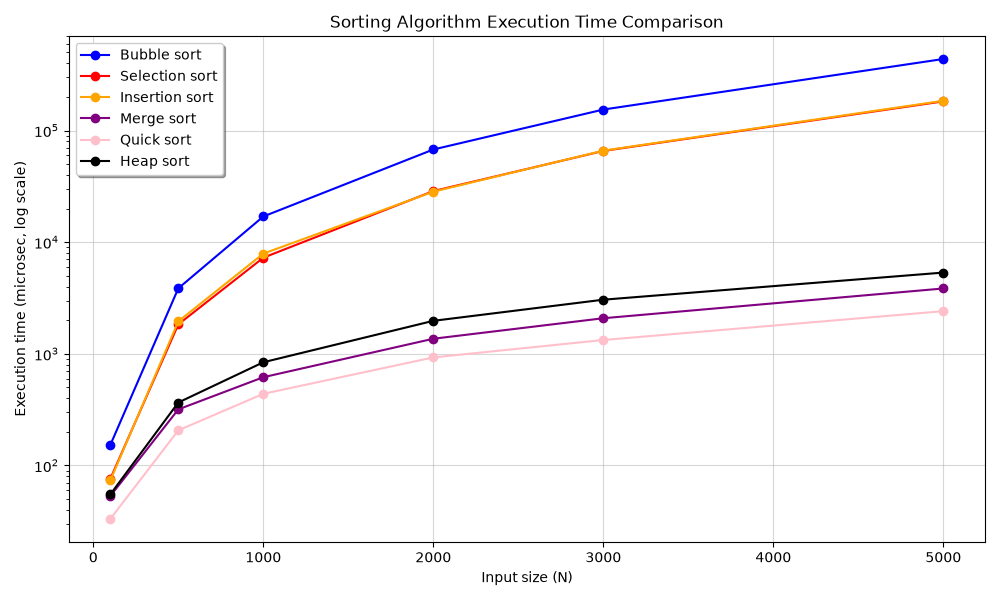

# Sorting Algorithm Comparison

A Python implementation of six comparison-based sorting algorithms, with a script that measures and plots their running times on random input of increasing size.

## Algorithms

- Bubble sort
- Selection sort
- Insertion sort
- Merge sort
- Quick sort (Hoare partition scheme)
- Heap sort

## Project structure

```
.
├── BubbleSort.py
├── SelectionSort.py
├── InsertionSort.py
├── MergeSort.py
├── QuickSort.py
├── HeapSort.py
├── GenerateArray.py
├── main.py
├── Compare.py
└── Figure_1.png
```

| File | Description |
|------|-------------|
| `BubbleSort.py`, `SelectionSort.py`, `InsertionSort.py` | Quadratic sorts. Each exposes a function that sorts a list in place. |
| `MergeSort.py`, `QuickSort.py`, `HeapSort.py` | O(n log n) sorts, with the same interface. |
| `GenerateArray.py` | Returns a list of random integers of a given size. |
| `main.py` | Sorts one small random list with every algorithm and prints the time taken by each. |
| `Compare.py` | Times every algorithm over a range of input sizes and plots the results. |

## Requirements

- Python 3.8 or later
- matplotlib (only needed for `Compare.py`)


## Method

For each input size (100, 500, 1000, 2000, 3000 and 5000), a random list is generated with `generate_array`, containing integers from 1 to 100. Each algorithm then sorts its own copy of that same list, so every algorithm sees identical input. Elapsed time is measured with `timeit.default_timer` and reported in microseconds. The y-axis of the plot uses a logarithmic scale so that both the quadratic and the O(n log n) algorithms remain visible on one chart.

## Results



The three quadratic algorithms (bubble, selection, insertion) grow much faster with input size than merge, quick and heap sort, which stay close together at the bottom of the chart. This matches their theoretical complexities, listed below.

### Time complexity

| Algorithm | Best | Average | Worst | Space | Stable |
|-----------|------|---------|-------|-------|--------|
| Bubble sort | O(n) | O(n²) | O(n²) | O(1) | Yes |
| Selection sort | O(n²) | O(n²) | O(n²) | O(1) | No |
| Insertion sort | O(n) | O(n²) | O(n²) | O(1) | Yes |
| Merge sort | O(n log n) | O(n log n) | O(n log n) | O(n) | Yes |
| Quick sort | O(n log n) | O(n log n) | O(n²) | O(log n) | No |
| Heap sort | O(n log n) | O(n log n) | O(n log n) | O(1) | No |

The best case for bubble sort assumes the early-exit check, which is implemented in `BubbleSort.py`.

## Implementation notes

Quick sort uses the Hoare partition scheme with the middle element as the pivot. Two indices move toward each other from opposite ends and swap elements that are on the wrong side of the pivot. After partitioning, the recursion continues on `[low, p]` and `[p + 1, high]`. This differs from the Lomuto scheme, where the pivot ends up in its final position and the recursion uses `p - 1` and `p + 1`.

## Limitations

- Each data point comes from a single run, so small timing differences between algorithms are within normal measurement noise.
- Only random input was tested. Behavior on sorted, reverse-sorted or heavily duplicated input was not measured.

## References

Quick sort
- [Quick Sort Algorithm, GeeksforGeeks](https://www.geeksforgeeks.org/dsa/quick-sort-algorithm/)
- [Hoare's vs Lomuto Partition Scheme, GeeksforGeeks](https://www.geeksforgeeks.org/dsa/hoares-vs-lomuto-partition-scheme-quicksort/)
- [Video: Michael Sambol](https://youtu.be/Hoixgm4-P4M?si=4V31GhMI6690Pa0o)

Bubble sort
- [Bubble Sort, GeeksforGeeks](https://www.geeksforgeeks.org/dsa/bubble-sort-algorithm/)
- [Video: Michael Sambol](https://youtu.be/xli_FI7CuzA?si=XyQI_9inGVqLfMY1)

Selection sort
- [Selection Sort, GeeksforGeeks](https://www.geeksforgeeks.org/dsa/selection-sort-algorithm-2/)
- [Video: Michael Sambol](https://youtu.be/g-PGLbMth_g?si=RTa0pnoGPz7O6epR)

Insertion sort
- [Insertion Sort, GeeksforGeeks](https://www.geeksforgeeks.org/dsa/insertion-sort-algorithm/)
- [Video: Michael Sambol](https://youtu.be/JU767SDMDvA?si=kY2vntBYvtJLcfLA)

Merge sort
- [Merge Sort, GeeksforGeeks](https://www.geeksforgeeks.org/dsa/merge-sort/)
- [Video: Michael Sambol](https://youtu.be/4VqmGXwpLqc?si=xfks0uw4JdU8plKZ)

Heap sort
- [Heap Sort, GeeksforGeeks](https://www.geeksforgeeks.org/dsa/heap-sort/)
- [Video: Michael Sambol](https://youtu.be/2DmK_H7IdTo?si=z5hT5IZDX-h-Nmfo)

## Author

Nada Hesham
